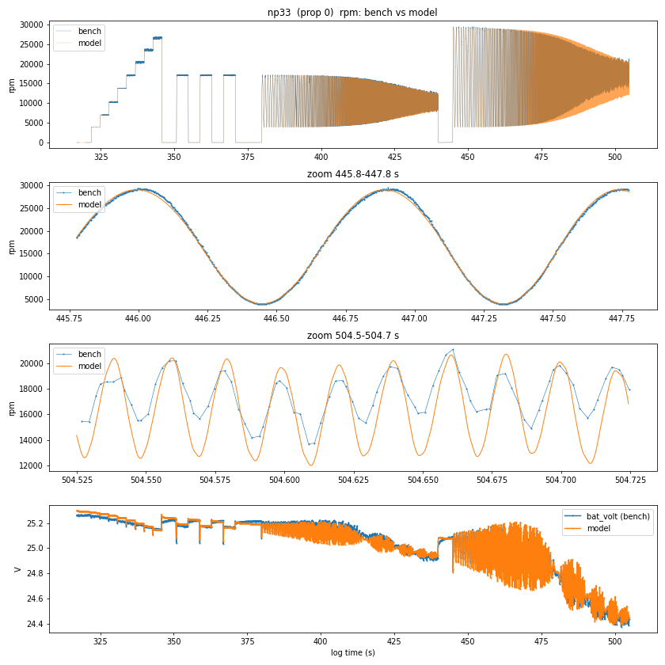
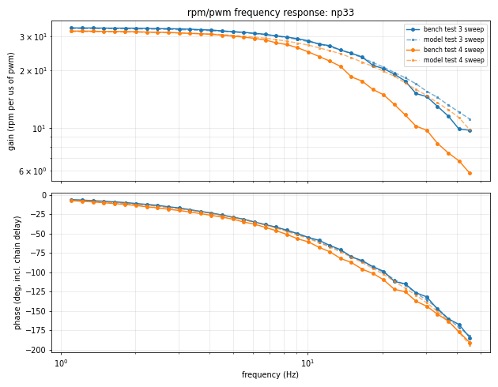
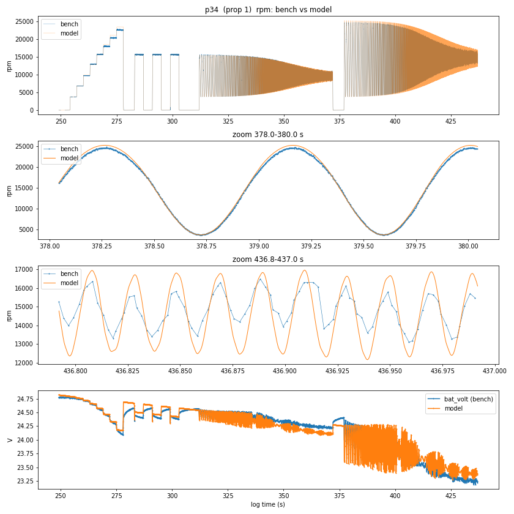
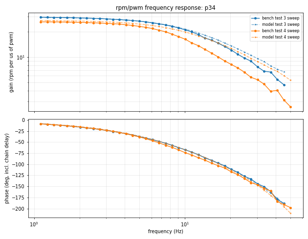
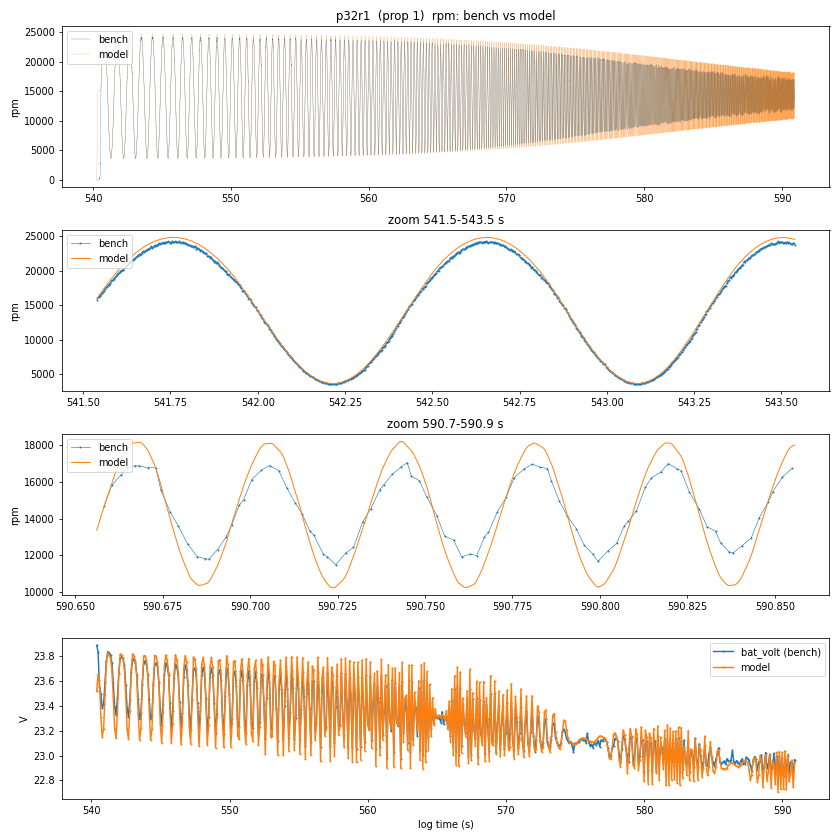
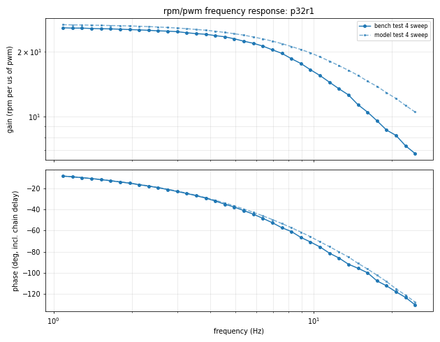
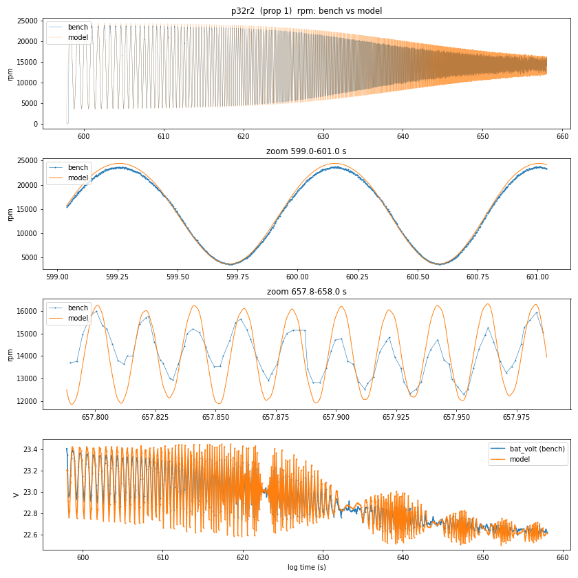
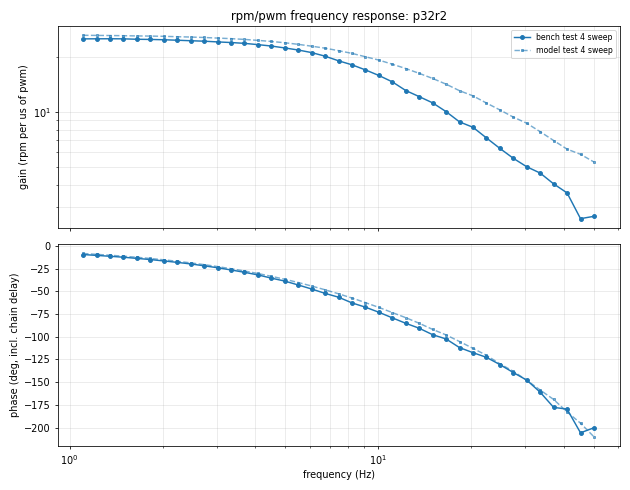
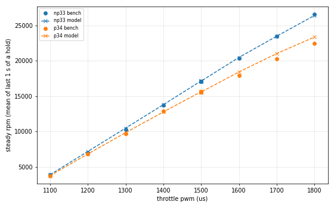

# Motor identification report

Generated by motorid 0.1.0 on 2026-10-26T15:11:03.  
Command: `motorid.py fit /home/fred/vehicles/hakea/logs/sdcard/00000033.BIN /home/fred/vehicles/hakea/logs/sdcard/00000034.BIN --validate /home/fred/vehicles/hakea/logs/sdcard/00000032.BIN --prop 32=on --eeprom /home/fred/Downloads/esc1_config.bin --out /home/fred/vehicles/hakea/notes/motorid --reference /home/fred/vehicles/hakea/notes/sim/calib/params_v2.json --firmware-hash /home/fred/vehicles/hakea/firmware/SHA256SUMS --prop-diameter 0.127`

## Inputs

| log | role | sha256 | excitation | run | window (s) | prop | how classified |
|---|---|---|---|---|---|---|---|
| 00000033.BIN | fit | `31000576ae9e...` | BNCH | np33 | 316.8-504.8 | off | heuristic (rpm/no-load speed 1.018 >= 0.96 at duty >= 0.6) |
| 00000034.BIN | fit | `1a8c029de70c...` | BNCH | p34 | 249.0-437.0 | on (type 1) | heuristic (rpm/no-load speed 0.909 <= 0.94 at duty >= 0.6) |
| 00000032.BIN | validate | `a08dda27883e...` | SWP | p32r1 | 540.3-590.9 | on (type 1) | command line |
| 00000032.BIN | validate | `a08dda27883e...` | SWP | p32r2 | 597.8-658.0 | on (type 1) | command line |

ESC settings: eeprom `/home/fred/Downloads/esc1_config.bin` (sha256 `a1ce48e4213b...`). Derived: min duty 40/2000, ramp (startup/low/high) 2/6/16 per 20 kHz tick, low-rpm limit 6..54 k-erpm, comp_pwm 1, brake_on_zero_throttle 0.

Firmware: `/home/fred/vehicles/hakea/firmware/SHA256SUMS` (sha256 `e1f7274ef3f3...`)

Measured channels used: bat_volt, rpm. Never used unless asked: FC battery current, ESC telemetry voltage/current, IMU.

## Identifiability

With only rpm and battery voltage, the model predicts *identical rpm* for any scale factor s applied as J, kq, b, T0 -> s x and R, Rb, L -> x / s (the motor current scales by s). Torque, current and heating do depend on s, so one absolute quantity must be known.

**This fit fixes s with the prior(s): R = 0.16 +- 0.04.** (This is the built-in default for Hakea's 2307; measure the phase-to-phase resistance and pass `--r-phase-phase`.) Absolute torque, current, inertia and loss numbers below are only as good as that prior; rpm predictions are not affected.

## Parameters

| parameter | value | 1-sigma | meaning |
|---|---|---|---|
| R | 0.1542 | 0.45% | loop resistance 2 R_phase + 2 Rds_on (ohm, 25 C) |
| L | 3e-05 | fixed | loop inductance (H, fixed) |
| T0 | 1.322e-06 | at lower bound (not identifiable) | Coulomb friction torque (N m) |
| b | 7.425e-06 | 1.3% | viscous friction (N m s/rad) |
| J_m | 3.335e-06 | 0.55% | rotor inertia (kg m^2) |
| delay | 0.005349 | 1.7e-05 | measurement chain delay (s) |
| Rb | 0.04339 | 0.53% | battery + wiring resistance (ohm) |
| g(rpm) | 1.017, 1.036, 1.043, 1.052, 1.012 | | effective voltage gain at 0/8000/14000/20000/30000 rpm |
| J_p (prop 1) | 2.227e-06 | 1.4% | prop + adapter inertia (kg m^2) |
| kq (prop 1) | 1.455e-08 | 0.79% | prop torque coefficient Q = kq w^2 (N m s^2) |

Kt = Ke = 0.00735 N m/A (nominal Kv 1300); effective Kv ~ 1356 rpm/V (Kv x mean g). Uncertainties are from the fit Jacobian (relative, % for log-space parameters) and are optimistic: residuals are strongly correlated in time.

Battery (open-circuit voltage V0 + V1 t, per run): np33 25.30 V -0.0017 V/s; p34 24.82 V -0.0044 V/s; p32r1 23.81 V -0.0072 V/s; p32r2 23.40 V -0.0033 V/s

## Fit and hold-out errors (rpm)

Fit samples: motor commanded and settled >= 0.5 s after a start, or coasting above 3500 rpm. Held out: test(s) 4 of every run, and all of the validation logs (battery state refitted only).

| run | test | role | rpm rms | mean error | rms / mean rpm | samples |
|---|---|---|---|---|---|---|
| np33 | 1 | fit | 160 | +72 | 1.0% | 10103 |
| np33 | 2 | fit | 180 | +29 | 1.1% | 4571 |
| np33 | 3 | fit | 256 | -29 | 2.5% | 25691 |
| np33 | 4 | holdout | 1231 | -511 | 7.2% | 25833 |
| np33 | voltage | | 0.034 V rms | | | |
| p34 | 1 | fit | 455 | +280 | 3.3% | 10698 |
| p34 | 2 | fit | 183 | -19 | 1.2% | 4848 |
| p34 | 3 | fit | 221 | -38 | 2.3% | 27199 |
| p34 | 4 | holdout | 892 | +34 | 6.1% | 27215 |
| p34 | voltage | | 0.102 V rms | | | |
| p32r1 | 4 | holdout | 796 | +99 | 5.5% | 22942 |
| p32r1 | voltage | | 0.081 V rms | | | |
| p32r2 | 4 | holdout | 858 | -8 | 6.0% | 27358 |
| p32r2 | voltage | | 0.084 V rms | | | |

Overall: fit 263 rpm rms, hold-out 959 rpm rms.

## Steady rpm vs throttle

Mean rpm over the end of every constant-throttle hold (test 1 = steps, 2 = coast-down holds).

| run | test | pwm | bench rpm | model rpm | error |
|---|---|---|---|---|---|
| np33 | 1 | 1100 | 3856 | 3895 | +1.0% |
| np33 | 1 | 1200 | 7027 | 7182 | +2.2% |
| np33 | 1 | 1300 | 10251 | 10485 | +2.3% |
| np33 | 1 | 1400 | 13754 | 13803 | +0.4% |
| np33 | 1 | 1500 | 17050 | 17154 | +0.6% |
| np33 | 1 | 1600 | 20369 | 20477 | +0.5% |
| np33 | 1 | 1700 | 23500 | 23482 | -0.1% |
| np33 | 1 | 1800 | 26574 | 26413 | -0.6% |
| np33 | 2 | 1500 | 17082 | 17132 | +0.3% |
| np33 | 2 | 1500 | 17089 | 17122 | +0.2% |
| np33 | 2 | 1500 | 17088 | 17113 | +0.1% |
| p34 | 1 | 1100 | 3757 | 3757 | -0.0% |
| p34 | 1 | 1200 | 6794 | 6831 | +0.5% |
| p34 | 1 | 1300 | 9658 | 9840 | +1.9% |
| p34 | 1 | 1400 | 12912 | 12772 | -1.1% |
| p34 | 1 | 1500 | 15647 | 15635 | -0.1% |
| p34 | 1 | 1600 | 17903 | 18424 | +2.9% |
| p34 | 1 | 1700 | 20262 | 21025 | +3.8% |
| p34 | 1 | 1800 | 22482 | 23366 | +3.9% |
| p34 | 2 | 1500 | 15569 | 15587 | +0.1% |
| p34 | 2 | 1500 | 15580 | 15566 | -0.1% |
| p34 | 2 | 1500 | 15554 | 15544 | -0.1% |

## Frequency response (rpm per us of pwm, phase incl. chain delay)

| run | test | f (Hz) | bench gain | model gain | bench phase | model phase |
|---|---|---|---|---|---|---|
| np33 | 3 | 1.11 | 33.2 | 33.0 | -6 | -6 |
| np33 | 3 | 3.01 | 32.8 | 32.5 | -17 | -18 |
| np33 | 3 | 10 | 28.4 | 28.1 | -55 | -56 |
| np33 | 3 | 20.3 | 20.4 | 20.7 | -99 | -100 |
| np33 | 3 | 33.5 | 13.0 | 14.4 | -148 | -146 |
| np33 | 3 | 45.2 | 9.7 | 11.1 | 175 | 178 |
| np33 | 4 | 1.11 | 31.9 | 31.7 | -7 | -7 |
| np33 | 4 | 3.01 | 31.2 | 31.2 | -20 | -18 |
| np33 | 4 | 10 | 24.9 | 27.0 | -61 | -56 |
| np33 | 4 | 20.3 | 14.9 | 19.7 | -110 | -103 |
| np33 | 4 | 33.5 | 8.3 | 13.5 | -154 | -151 |
| np33 | 4 | 45.2 | 5.8 | 9.8 | 169 | 166 |
| p34 | 3 | 1.11 | 29.6 | 29.4 | -9 | -9 |
| p34 | 3 | 3.01 | 28.3 | 28.3 | -24 | -23 |
| p34 | 3 | 10 | 21.0 | 21.4 | -67 | -67 |
| p34 | 3 | 20.3 | 12.1 | 13.6 | -112 | -111 |
| p34 | 3 | 33.5 | 6.8 | 8.8 | -151 | -155 |
| p34 | 3 | 45.2 | 4.7 | 6.7 | 171 | 171 |
| p34 | 4 | 1.11 | 26.0 | 27.0 | -9 | -8 |
| p34 | 4 | 3.01 | 25.0 | 26.1 | -24 | -23 |
| p34 | 4 | 10 | 16.2 | 19.8 | -74 | -67 |
| p34 | 4 | 20.3 | 8.2 | 12.6 | -117 | -113 |
| p34 | 4 | 33.5 | 4.8 | 8.1 | -155 | -158 |
| p34 | 4 | 50 | 2.6 | 5.3 | 162 | 150 |
| p32r1 | 4 | 1.09 | 25.7 | 26.6 | -8 | -8 |
| p32r1 | 4 | 2.99 | 24.7 | 25.7 | -23 | -23 |
| p32r1 | 4 | 9.71 | 16.5 | 19.7 | -71 | -66 |
| p32r1 | 4 | 20.7 | 8.2 | 12.1 | -118 | -115 |
| p32r1 | 4 | 24.5 | 6.8 | 10.5 | -130 | -128 |
| p32r2 | 4 | 1.11 | 25.1 | 26.2 | -10 | -8 |
| p32r2 | 4 | 3.02 | 24.1 | 25.3 | -24 | -23 |
| p32r2 | 4 | 10 | 15.8 | 19.2 | -73 | -68 |
| p32r2 | 4 | 20.3 | 8.2 | 12.2 | -118 | -113 |
| p32r2 | 4 | 33.5 | 4.6 | 7.8 | -161 | -159 |
| p32r2 | 4 | 50 | 2.7 | 5.3 | 160 | 150 |

## Derived: speed and bandwidth vs throttle (model, steady state)

Rotation frequency = rpm/60 is the 1st motor harmonic (useful for notch planning). Bandwidth is the small-signal duty->speed -3 dB frequency without ramp limit or delay; tau = 1/(2 pi f3dB).

| prop | V | pwm | rpm | rotation Hz | f3dB (Hz) | tau (ms) |
|---|---|---|---|---|---|---|
| off | 25.3 | 1200 | 7187 | 120 | 17.5 | 9.1 |
| off | 25.3 | 1300 | 10495 | 175 | 17.1 | 9.3 |
| off | 25.3 | 1400 | 13819 | 230 | 16.8 | 9.5 |
| off | 25.3 | 1500 | 17177 | 286 | 16.4 | 9.7 |
| off | 25.3 | 1600 | 20506 | 342 | 15.7 | 10.1 |
| off | 25.3 | 1700 | 23520 | 392 | 15.4 | 10.3 |
| off | 25.3 | 1800 | 26459 | 441 | 14.8 | 10.8 |
| 1 | 23.8 | 1200 | 6568 | 109 | 11.0 | 14.5 |
| 1 | 23.8 | 1300 | 9472 | 158 | 11.0 | 14.5 |
| 1 | 23.8 | 1400 | 12304 | 205 | 11.0 | 14.5 |
| 1 | 23.8 | 1500 | 15073 | 251 | 11.0 | 14.5 |
| 1 | 23.8 | 1600 | 17777 | 296 | 11.0 | 14.5 |
| 1 | 23.8 | 1700 | 20367 | 339 | 11.0 | 14.5 |
| 1 | 23.8 | 1800 | 22658 | 378 | 10.7 | 14.8 |

## Comparison with reference `/home/fred/vehicles/hakea/notes/sim/calib/params_v2.json`

| parameter | this fit | reference | ratio |
|---|---|---|---|
| J_m | 3.335e-06 | 3.307e-06 | 1.008 |
| J_p | 2.227e-06 | 2.069e-06 | 1.076 |
| R | 0.1542 | 0.1586 | 0.972 |
| Rb | 0.04339 | 0.04402 | 0.986 |
| T0 | 1.322e-06 | 8.684e-10 | 1522.772 |
| V0_np33 | 25.3 | 25.3 | 1.000 |
| V0_p34 | 24.82 | 24.84 | 0.999 |
| V1_np33 | -0.001725 | -0.001806 | 0.955 |
| V1_p34 | -0.004422 | -0.00469 | 0.943 |
| b | 7.425e-06 | 6.621e-06 | 1.121 |
| delay | 0.005349 | 0.005251 | 1.019 |
| g0 | 1.017 | 1.081 | 0.941 |
| g1 | 1.036 | 1.014 | 1.021 |
| g2 | 1.043 | 1.06 | 0.984 |
| g3 | 1.052 | 1.035 | 1.016 |
| g4 | 1.012 | 0.9708 | 1.042 |
| kq | 1.455e-08 | 1.52e-08 | 0.958 |

## Files

- `motor_model.json`: full model + provenance; `avgmodel_params*.json`: flat parameters for Hakea's scripts/sim (calibrate.py / predict_blind.py layout); `escsim_*.json`: ESCSim SITL model files.
- 
- 
- 
- 
- 
- 
- 
- 
- 
