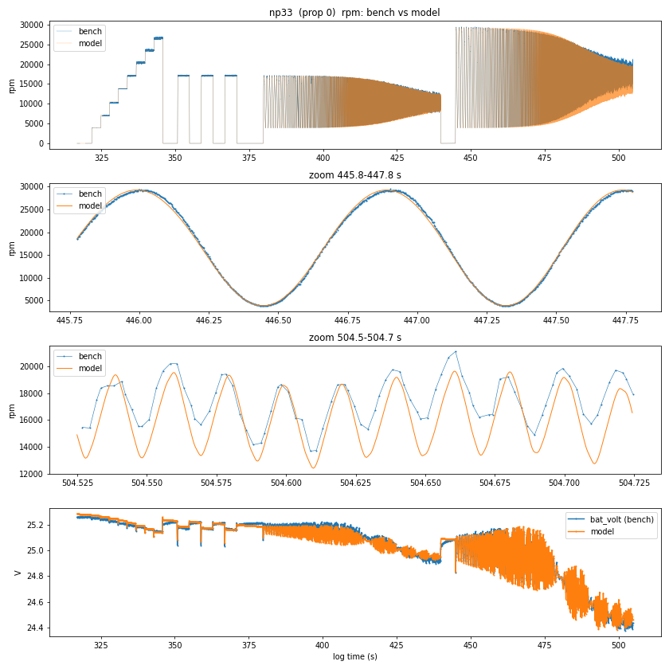
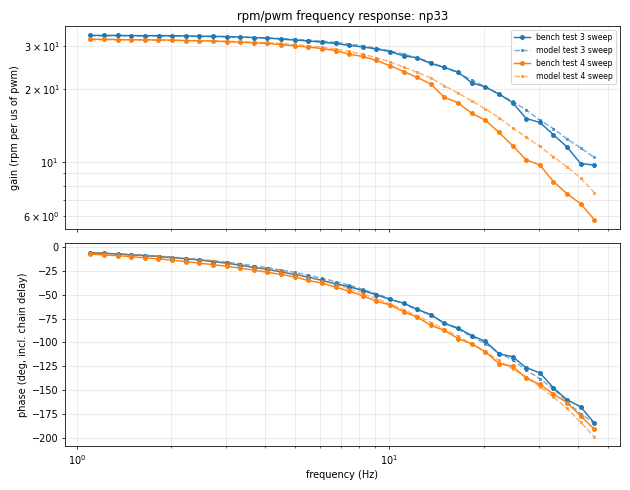
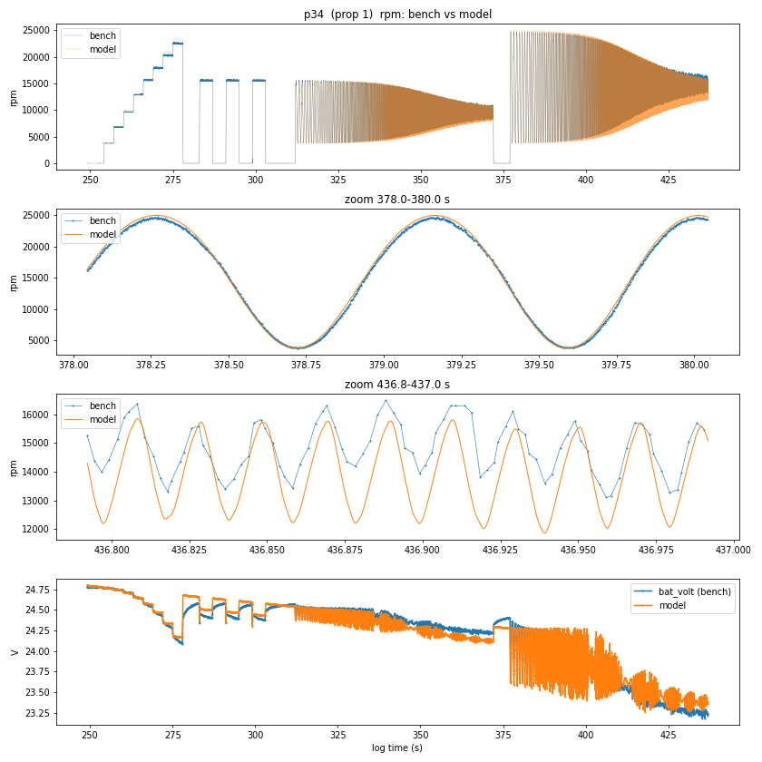
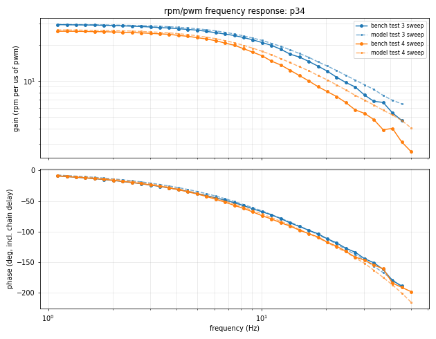
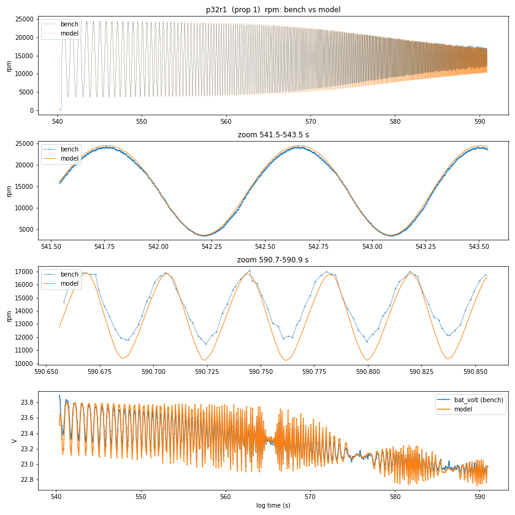
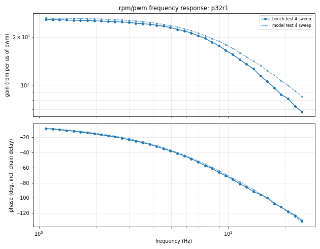
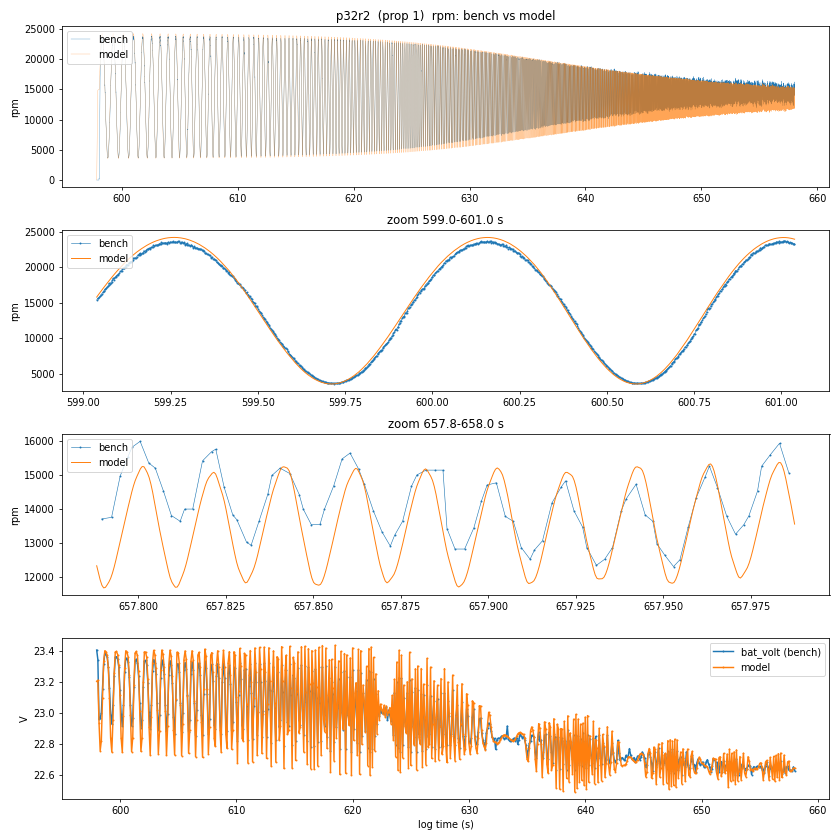
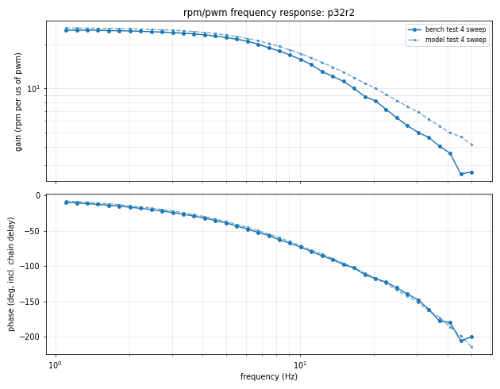
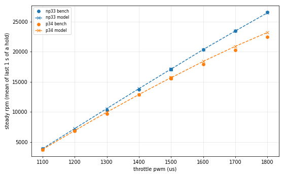

# Motor identification report

Generated by motorid 0.1.0 on 2026-10-26T14:59:33.  
Command: `motorid.py fit /home/fred/vehicles/hakea/logs/sdcard/00000033.BIN /home/fred/vehicles/hakea/logs/sdcard/00000034.BIN --validate /home/fred/vehicles/hakea/logs/sdcard/00000032.BIN --prop 32=on --eeprom /home/fred/Downloads/esc1_config.bin --out /home/fred/vehicles/hakea/notes/motorid --reference /home/fred/vehicles/hakea/notes/sim/calib/params_v2.json --firmware-hash /home/fred/vehicles/hakea/firmware/SHA256SUMS --prop-diameter 0.127 --free Isat --tag _isat`

## Inputs

| log | role | sha256 | excitation | run | window (s) | prop | how classified |
|---|---|---|---|---|---|---|---|
| 00000033.BIN | fit | `31000576ae9e...` | BNCH | np33 | 316.8-504.8 | off | heuristic (rpm/no-load speed 1.018 >= 0.96 at duty >= 0.6) |
| 00000034.BIN | fit | `1a8c029de70c...` | BNCH | p34 | 249.0-437.0 | on (type 1) | heuristic (rpm/no-load speed 0.909 <= 0.94 at duty >= 0.6) |
| 00000032.BIN | validate | `a08dda27883e...` | SWP | p32r1 | 540.3-590.9 | on (type 1) | command line |
| 00000032.BIN | validate | `a08dda27883e...` | SWP | p32r2 | 597.8-658.0 | on (type 1) | command line |

ESC settings: eeprom `/home/fred/Downloads/esc1_config.bin` (sha256 `a1ce48e4213b...`). Derived: min duty 40/2000, ramp (startup/low/high) 2/6/16 per 20 kHz tick, low-rpm limit 6..54 k-erpm, comp_pwm 1, brake_on_zero_throttle 0.

Firmware: `/home/fred/vehicles/hakea/firmware/SHA256SUMS` (sha256 `e1f7274ef3f3...`)

Measured channels used: bat_volt, rpm. Never used unless asked: FC battery current, ESC telemetry voltage/current, IMU.

## Identifiability

With only rpm and battery voltage, the model predicts *identical rpm* for any scale factor s applied as J, kq, b, T0 -> s x and R, Rb, L -> x / s (the motor current scales by s). Torque, current and heating do depend on s, so one absolute quantity must be known.

**This fit fixes s with the prior(s): R = 0.16 +- 0.04.** (This is the built-in default for Hakea's 2307; measure the phase-to-phase resistance and pass `--r-phase-phase`.) Absolute torque, current, inertia and loss numbers below are only as good as that prior; rpm predictions are not affected.

## Parameters

| parameter | value | 1-sigma | meaning |
|---|---|---|---|
| R | 0.1584 | 0.39% | loop resistance 2 R_phase + 2 Rds_on (ohm, 25 C) |
| L | 3e-05 | fixed | loop inductance (H, fixed) |
| T0 | 6.543e-06 | unconstrained | Coulomb friction torque (N m) |
| b | 7.31e-06 | 2.2% | viscous friction (N m s/rad) |
| J_m | 2.501e-06 | 0.65% | rotor inertia (kg m^2) |
| delay | 0.005447 | 1.6e-05 | measurement chain delay (s) |
| Rb | 0.0415 | 0.47% | battery + wiring resistance (ohm) |
| Isat | 62.49 | 1.8% | torque-constant roll-off current (A) |
| g(rpm) | 1.004, 1.045, 1.049, 1.046, 1.021 | | effective voltage gain at 0/8000/14000/20000/30000 rpm |
| J_p (prop 1) | 1.541e-06 | 1.2% | prop + adapter inertia (kg m^2) |
| kq (prop 1) | 1.179e-08 | 0.66% | prop torque coefficient Q = kq w^2 (N m s^2) |

Kt = Ke = 0.00735 N m/A (nominal Kv 1300); effective Kv ~ 1361 rpm/V (Kv x mean g). Uncertainties are from the fit Jacobian (relative, % for log-space parameters) and are optimistic: residuals are strongly correlated in time.

Battery (open-circuit voltage V0 + V1 t, per run): np33 25.29 V -0.0016 V/s; p34 24.80 V -0.0041 V/s; p32r1 23.79 V -0.0053 V/s; p32r2 23.39 V -0.0019 V/s

## Fit and hold-out errors (rpm)

Fit samples: motor commanded and settled >= 0.5 s after a start, or coasting above 3500 rpm. Held out: test(s) 4 of every run, and all of the validation logs (battery state refitted only).

| run | test | role | rpm rms | mean error | rms / mean rpm | samples |
|---|---|---|---|---|---|---|
| np33 | 1 | fit | 177 | +83 | 1.1% | 10103 |
| np33 | 2 | fit | 97 | +21 | 0.6% | 4571 |
| np33 | 3 | fit | 268 | -34 | 2.6% | 25691 |
| np33 | 4 | holdout | 1069 | -633 | 6.3% | 25833 |
| np33 | voltage | | 0.028 V rms | | | |
| p34 | 1 | fit | 398 | +289 | 2.9% | 10698 |
| p34 | 2 | fit | 128 | +73 | 0.8% | 4848 |
| p34 | 3 | fit | 298 | -83 | 3.1% | 27199 |
| p34 | 4 | holdout | 790 | -418 | 5.4% | 27215 |
| p34 | voltage | | 0.090 V rms | | | |
| p32r1 | 4 | holdout | 679 | -276 | 4.7% | 22942 |
| p32r1 | voltage | | 0.078 V rms | | | |
| p32r2 | 4 | holdout | 801 | -413 | 5.6% | 27358 |
| p32r2 | voltage | | 0.079 V rms | | | |

Overall: fit 276 rpm rms, hold-out 847 rpm rms.

## Steady rpm vs throttle

Mean rpm over the end of every constant-throttle hold (test 1 = steps, 2 = coast-down holds).

| run | test | pwm | bench rpm | model rpm | error |
|---|---|---|---|---|---|
| np33 | 1 | 1100 | 3856 | 3887 | +0.8% |
| np33 | 1 | 1200 | 7027 | 7230 | +2.9% |
| np33 | 1 | 1300 | 10251 | 10558 | +3.0% |
| np33 | 1 | 1400 | 13754 | 13868 | +0.8% |
| np33 | 1 | 1500 | 17050 | 17133 | +0.5% |
| np33 | 1 | 1600 | 20369 | 20365 | -0.0% |
| np33 | 1 | 1700 | 23500 | 23448 | -0.2% |
| np33 | 1 | 1800 | 26574 | 26477 | -0.4% |
| np33 | 2 | 1500 | 17082 | 17114 | +0.2% |
| np33 | 2 | 1500 | 17089 | 17106 | +0.1% |
| np33 | 2 | 1500 | 17088 | 17097 | +0.1% |
| p34 | 1 | 1100 | 3757 | 3755 | -0.1% |
| p34 | 1 | 1200 | 6794 | 6894 | +1.5% |
| p34 | 1 | 1300 | 9658 | 9952 | +3.0% |
| p34 | 1 | 1400 | 12912 | 12893 | -0.1% |
| p34 | 1 | 1500 | 15647 | 15711 | +0.4% |
| p34 | 1 | 1600 | 17903 | 18394 | +2.7% |
| p34 | 1 | 1700 | 20262 | 20906 | +3.2% |
| p34 | 1 | 1800 | 22482 | 23208 | +3.2% |
| p34 | 2 | 1500 | 15569 | 15669 | +0.6% |
| p34 | 2 | 1500 | 15580 | 15650 | +0.4% |
| p34 | 2 | 1500 | 15554 | 15631 | +0.5% |

## Frequency response (rpm per us of pwm, phase incl. chain delay)

| run | test | f (Hz) | bench gain | model gain | bench phase | model phase |
|---|---|---|---|---|---|---|
| np33 | 3 | 1.11 | 33.2 | 33.0 | -6 | -6 |
| np33 | 3 | 3.01 | 32.8 | 32.7 | -17 | -16 |
| np33 | 3 | 10 | 28.4 | 28.7 | -55 | -54 |
| np33 | 3 | 20.3 | 20.4 | 20.4 | -99 | -101 |
| np33 | 3 | 33.5 | 13.0 | 13.7 | -148 | -149 |
| np33 | 3 | 45.2 | 9.7 | 10.5 | 175 | 175 |
| np33 | 4 | 1.11 | 31.9 | 31.8 | -7 | -6 |
| np33 | 4 | 3.01 | 31.2 | 31.4 | -20 | -17 |
| np33 | 4 | 10 | 24.9 | 25.8 | -61 | -59 |
| np33 | 4 | 20.3 | 14.9 | 16.5 | -110 | -110 |
| np33 | 4 | 33.5 | 8.3 | 10.5 | -154 | -157 |
| np33 | 4 | 45.2 | 5.8 | 7.5 | 169 | 161 |
| p34 | 3 | 1.11 | 29.6 | 29.7 | -9 | -7 |
| p34 | 3 | 3.01 | 28.3 | 28.8 | -24 | -21 |
| p34 | 3 | 10 | 21.0 | 21.8 | -67 | -66 |
| p34 | 3 | 20.3 | 12.1 | 13.4 | -112 | -112 |
| p34 | 3 | 33.5 | 6.8 | 8.5 | -151 | -156 |
| p34 | 3 | 45.2 | 4.7 | 6.5 | 171 | 169 |
| p34 | 4 | 1.11 | 26.0 | 26.7 | -9 | -8 |
| p34 | 4 | 3.01 | 25.0 | 25.7 | -24 | -22 |
| p34 | 4 | 10 | 16.2 | 17.7 | -74 | -71 |
| p34 | 4 | 20.3 | 8.2 | 10.2 | -117 | -118 |
| p34 | 4 | 33.5 | 4.8 | 6.3 | -155 | -163 |
| p34 | 4 | 50 | 2.6 | 4.1 | 162 | 145 |
| p32r1 | 4 | 1.09 | 25.7 | 26.3 | -8 | -8 |
| p32r1 | 4 | 2.99 | 24.7 | 25.4 | -23 | -22 |
| p32r1 | 4 | 9.71 | 16.5 | 17.9 | -71 | -69 |
| p32r1 | 4 | 20.7 | 8.2 | 9.9 | -118 | -119 |
| p32r1 | 4 | 24.5 | 6.8 | 8.5 | -130 | -132 |
| p32r2 | 4 | 1.11 | 25.1 | 26.0 | -10 | -8 |
| p32r2 | 4 | 3.02 | 24.1 | 25.0 | -24 | -22 |
| p32r2 | 4 | 10 | 15.8 | 17.3 | -73 | -71 |
| p32r2 | 4 | 20.3 | 8.2 | 10.1 | -118 | -117 |
| p32r2 | 4 | 33.5 | 4.6 | 6.2 | -161 | -163 |
| p32r2 | 4 | 50 | 2.7 | 4.2 | 160 | 146 |

## Derived: speed and bandwidth vs throttle (model, steady state)

Rotation frequency = rpm/60 is the 1st motor harmonic (useful for notch planning). Bandwidth is the small-signal duty->speed -3 dB frequency without ramp limit or delay; tau = 1/(2 pi f3dB).

| prop | V | pwm | rpm | rotation Hz | f3dB (Hz) | tau (ms) |
|---|---|---|---|---|---|---|
| off | 25.3 | 1200 | 7237 | 121 | 22.6 | 7.0 |
| off | 25.3 | 1300 | 10571 | 176 | 22.2 | 7.2 |
| off | 25.3 | 1400 | 13890 | 231 | 21.7 | 7.3 |
| off | 25.3 | 1500 | 17165 | 286 | 21.2 | 7.5 |
| off | 25.3 | 1600 | 20408 | 340 | 20.8 | 7.7 |
| off | 25.3 | 1700 | 23505 | 392 | 19.9 | 8.0 |
| off | 25.3 | 1800 | 26549 | 442 | 19.5 | 8.2 |
| 1 | 23.8 | 1200 | 6630 | 111 | 14.5 | 11.0 |
| 1 | 23.8 | 1300 | 9604 | 160 | 14.8 | 10.8 |
| 1 | 23.8 | 1400 | 12479 | 208 | 14.8 | 10.8 |
| 1 | 23.8 | 1500 | 15273 | 255 | 14.5 | 11.0 |
| 1 | 23.8 | 1600 | 17970 | 299 | 14.5 | 11.0 |
| 1 | 23.8 | 1700 | 20562 | 343 | 14.5 | 11.0 |
| 1 | 23.8 | 1800 | 22985 | 383 | 14.2 | 11.2 |

## Comparison with reference `/home/fred/vehicles/hakea/notes/sim/calib/params_v2.json`

| parameter | this fit | reference | ratio |
|---|---|---|---|
| J_m | 2.501e-06 | 3.307e-06 | 0.756 |
| J_p | 1.541e-06 | 2.069e-06 | 0.745 |
| R | 0.1584 | 0.1586 | 0.998 |
| Rb | 0.0415 | 0.04402 | 0.943 |
| T0 | 6.543e-06 | 8.684e-10 | 7534.811 |
| V0_np33 | 25.29 | 25.3 | 1.000 |
| V0_p34 | 24.8 | 24.84 | 0.998 |
| V1_np33 | -0.00156 | -0.001806 | 0.864 |
| V1_p34 | -0.004056 | -0.00469 | 0.865 |
| b | 7.31e-06 | 6.621e-06 | 1.104 |
| delay | 0.005447 | 0.005251 | 1.037 |
| g0 | 1.004 | 1.081 | 0.929 |
| g1 | 1.045 | 1.014 | 1.031 |
| g2 | 1.049 | 1.06 | 0.990 |
| g3 | 1.046 | 1.035 | 1.011 |
| g4 | 1.021 | 0.9708 | 1.052 |
| kq | 1.179e-08 | 1.52e-08 | 0.775 |

## Files

- `motor_model_isat.json`: full model + provenance; `avgmodel_params*.json`: flat parameters for Hakea's scripts/sim (calibrate.py / predict_blind.py layout); `escsim_*.json`: ESCSim SITL model files.
- 
- 
- 
- 
- 
- 
- 
- 
- 
